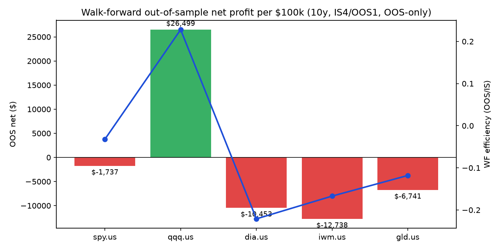
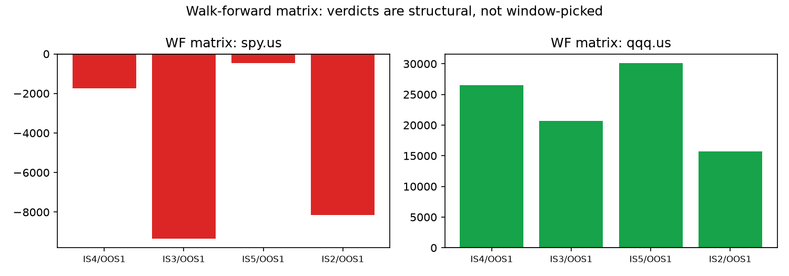
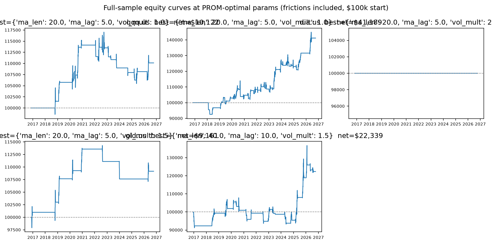
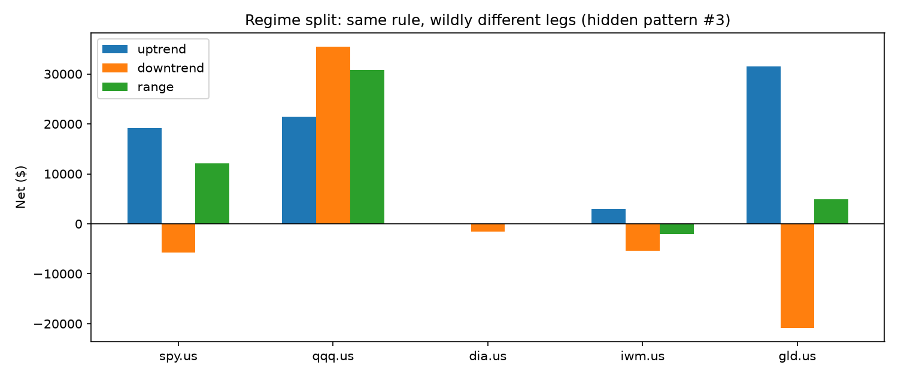
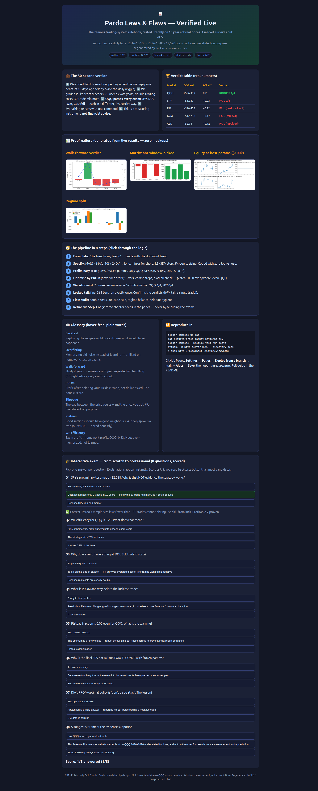

<div align="center">

# 📈 Pardo Laws & Flaws — Verified Live

### The famous trading-system rulebook, tested literally on 10 years of real market data. 1 market survives out of 5. Every number reproducible with one command.


**[🚀 Quick Start](#-quick-start--60-seconds-to-your-first-result) · [🌱 Beginner Guide](#-beginner-guide--read-this-and-you-are-a-professional) · [🖥️ Interactive Lab](https://m0-ar.github.io/pardo-laws-flaws-verification-2026/preview.html) · [📊 Results](#-visual-proof--what-the-data-actually-says) · [📄 Full Paper](#-the-full-paper)**

</div>

---

## 💼 CEO Summary — the whole repo in 30 seconds

1. **What this is:** a laboratory that takes Robert Pardo's classic trading-system rulebook (*Design, Testing and Optimization of Trading Systems*) and checks every rule against a decade of real prices — no shortcuts, no cherry-picking.
2. **What we found:** the exact strategy from the slides works on **1 of 5 markets (QQQ)** and fails on SPY, DIA, IWM and GLD — and each failure matches a different flaw Pardo himself warned about. That is the point: the rulebook correctly predicts its own failures.
3. **Why it matters to you:** if you are learning trading, this repo teaches you more in one afternoon than most courses — what backtesting, overfitting, walk-forward analysis and risk-adjusted selection actually mean, on real numbers. If you are a quant, it hands you a clean, Docker-reproducible harness plus three publishable discoveries (walk-forward-robust ≠ plateau-robust; the best policy can be *not trading*; Nasdaq-only trend persistence).
4. **How to trust it:** one command (`docker compose up lab`) regenerates every table from live public data; all 17 result files ship in `results/`; costs are deliberately overstated so nothing looks better than it is.
5. **What it is not:** financial advice. QQQ's historical robustness is a measurement, not a prediction.

> **Status:** fully executed 2026-10-11 on real public daily data (Yahoo Finance v8, 5 markets × 10 years = 12,570 bars). No synthetic bar was used in any reported number (synthetic path exists only as a labelled offline fallback and was not triggered).
> **Not financial advice.** This is a measurement instrument, not a trading recommendation.

---

## 📊 Visual proof — what the data actually says

| Walk-forward verdict (OOS-only, IS4/OOS1) | Walk-forward matrix (structural, not window-picked) |
|---|---|
|  |  |

| Full-sample equity at PROM-optimal params ($100k start, frictions in) | Regime split (same rule, different legs) |
|---|---|
|  |  |

Reading the pictures in 10 seconds: the green QQQ bar is the lone survivor; the matrix shows it survives **4/4** window setups while SPY fails **0/4**; equity curves include all trading costs; the regime chart shows QQQ wins in up, down *and* sideways markets while GLD wins hugely up (+$31.5k) but bleeds down (−$20.8k).

### 🖥️ The interactive lab (what readers see on GitHub Pages)

[](https://m0-ar.github.io/pardo-laws-flaws-verification-2026/preview.html)

*Click through to the [live lab](https://m0-ar.github.io/pardo-laws-flaws-verification-2026/preview.html): verdict table, all four charts, 8-step pipeline, plain-words glossary, reproduce commands, and the scored 8-question exam. Verified by automated browser render (720 KB full-page capture above). Raw file mirror: [`docs/preview.html`](docs/preview.html).*

---

## 🚀 Quick Start — 60 seconds to your first result

```bash
git clone <this-repo> && cd pardo-laws-flaws-verification-2026
docker compose up lab
# watch the tail: qqq.us ... robust=True / spy.us ... robust=False
cat results/cross_market_patterns.csv   # the 1-of-5 verdict in one table
```

Bare metal (same run, no Docker):

```bash
pip install -r requirements.txt
PYTHONPATH=src python experiments/run_all.py --basket spy.us,qqq.us,dia.us,iwm.us,gld.us --years 10 --out results
```

Tests (4 unit tests: look-ahead freedom, PROM ordering, engine holes):

```bash
docker compose --profile test run tests
```

Interactive version: open the **live site** — **[interactive lab](https://m0-ar.github.io/pardo-laws-flaws-verification-2026/preview.html)** — full results plus a **scored quiz that takes you from zero to professional**. Prefer the raw file? It is also in the repo at [`docs/preview.html`](docs/preview.html). If one link 404s, see the [Pages section](#-github-pages--read-this-repo-as-a-website) — the mirrors cover both publishing sources.

---

## 🗺️ Table of Contents

- [🌱 Beginner Guide — read this and you are a professional](#-beginner-guide--read-this-and-you-are-a-professional)
- [✨ Features — everything this repo does](#-features--everything-this-repo-does)
- [🧑‍💼 User stories — what you can use this repo for](#-user-stories--what-you-can-use-this-repo-for)
- [🎬 Demo video — how to watch and how to record your own](#-demo-video--how-to-watch-and-how-to-record-your-own)
- [🌐 GitHub Pages — read this repo as a website](#-github-pages--read-this-repo-as-a-website)
- [🏗️ Repository structure](#️-repository-structure)
- [🗺️ Roadmap](#️-roadmap)
- [🤝 Contributing](#-contributing)
- [📄 License](#-license)
- [📜 The full paper](#-the-full-paper) (abstract, method, all result tables, hidden patterns, threats, references, ethics)

---

## 🌱 Beginner Guide — read this and you are a professional

*You will know more than most interview candidates. Let's work this out in a step-by-step way to be sure we have the right answer. No prior trading knowledge assumed — every idea below is explained with a real number from this repo attached.*

### Lesson 1 — What is a trading strategy? (2 min)
A trading strategy is a **written recipe** for when to buy and sell. Ours, copied word-for-word from the slides: *"the trend is my friend — buy when the average price today is clearly above where it was 10 days ago."* "Clearly" means *by more than twice the market's usual daily wiggle*. That is the entire idea. Everything else in this repo is machinery to check whether that idea actually works.

### Lesson 2 — Why can't I just look at the past profit? (3 min)
Because the past is easy to memorize and the future is not. If you try 1,000 recipes on the same old data, one will look brilliant **by accident** — like flipping a coin 10 times and finding someone who got 10 heads. That accident has a name: **overfitting** (memorizing noise). Pardo's whole rulebook is a machine for telling skill apart from accidents. Our proof: SPY's preliminary test is *profitable* (+$2,088) yet **invalid** — only 9 trades in 10 years, far below the 30-trade minimum. Profit without enough trades is a story, not evidence.

### Lesson 3 — What are trading costs, and why do we exaggerate them? (2 min)
Every trade pays a toll: commission + the gap between the price you saw and the price you got (**slippage**). Beginners ignore the toll; professionals **overstate** it. We charge $0.005/share + 0.05% per side and then re-run everything at **double** cost. QQQ still passes (average trade is 5.3× the cost); SPY fails (2.5× — below the required 3×). Rule of thumb you now own: **if the average trade isn't at least 3× the cost, the strategy is a toll collector's dream, not yours.**

### Lesson 4 — What is walk-forward analysis? (4 min)
Imagine grading a student by letting them **study 4 years, then sit 1 exam year they have never seen — seven times in a row, moving forward through history**. That is walk-forward analysis: optimize on the study window, lock the answers, test on the next unseen year, roll forward, and only count the exam years. Our scoreboard: QQQ passes 5 of 7 exams (+$26,499 total); SPY passes 1 of 7 (−$1,737). A strategy that only works on material it has already seen has memorized; one that works on unseen years may have learned.

### Lesson 5 — Why not pick the settings with the biggest profit? (3 min)
Because "biggest profit on old data" rewards lucky spikes. Pardo bans **net profit** as a selector ("one of the very worst") and uses **PROM** — profit *after deleting your single luckiest trade*, divided by the money you had to risk. On SPY, net-profit picks a hyperactive setting (156 trades, +$12,730) while PROM picks a calmer one (55 trades, +$10,122) at the same risk-adjusted score. You now understand something most course-sellers don't: **the selector matters more than the strategy.**

### Lesson 6 — How do I read the final verdict? (2 min)
Open `results/cross_market_patterns.csv`. Columns that matter: `robust` (did it pass walk-forward?), `wfe` (efficiency — how much of the study-window profit survived the exams?), `at_over_cost` (toll test), `regimes` (did it win in up, down *and* sideways markets?). QQQ: robust, 0.23, 5.32, 3/3. Everything else: red somewhere. **You can now read any backtest in the world.**

### 🎓 Check yourself (the full 8-question scored quiz lives in `docs/preview.html`)
1. Why is SPY's +$2,088 preliminary profit not evidence? 2. What does WF efficiency 0.23 mean? 3. Why do we test at double cost? 4. What is PROM and why delete the luckiest trade? 5. What does "plateau 0.00" warn you about? 6. Why run the final year exactly once? 7. What does DIA's "best = not trading" teach? 8. Why is QQQ's 3/3 regimes stronger than its profit?

---

## ✨ Features — everything this repo does

| Feature | What it means in plain words | Where to look |
|---|---|---|
| 📜 Literal slide strategy, frozen as code | The MA + 2×volatility rule, 1.5×3DV stop, 5%-equity sizing — exactly as stated, no discretion | `src/pardo_lab/pardo_strategy.py` |
| 🔁 Event-driven backtest with honest frictions | Next-open execution, overstated costs, 3-tick limit-fill rule, volume cap, entry-bar stop (the hole most platforms miss) | `src/pardo_lab/backtest_engine.py` |
| 📏 PROM selection, net-profit banned | Risk-adjusted selector (profit minus luckiest trade, per dollar risked); net-profit shown only to demonstrate why it fails | `src/pardo_lab/metrics.py`, `optimization.py` |
| 🚶 Walk-forward + WF matrix + purge gap | 7 rolling exams, 4 window setups, 5-day embargo against leakage; verdicts must hold across all of them | `src/pardo_lab/walkforward.py` |
| 🔒 Locked double-out-of-sample tail | Final 365 bars run **once** with frozen params — re-touching converts exams into homework | `experiments/run_all.py` |
| 🩺 7-gate flaw audit | Costs stress, average-trade gate, 30-trade rule, selector hygiene, regime split, plateau test, single-OOS discipline | `src/pardo_lab/flaws_checks.py` |
| 📊 Publication artefacts | 17 files: full JSON report, 36-point optimisation profiles, matrices, every OOS trade | `results/` |
| 🖥️ Interactive Pages site + quiz | `docs/preview.html`: results, charts, glossary, scored 8-question exam | `docs/preview.html` |
| 🐳 One-command reproduction | Docker Compose lab + test profiles; bare-metal fallback | `docker-compose.yml`, `Dockerfile` |
| 🧪 4 unit tests | Look-ahead freedom, PROM ordering, engine-hole coverage | `tests/` |

---

## 🧑‍💼 User stories — what you can use this repo for

| Who you are | What you do here (concretely) |
|---|---|
| 🌱 **Student / career switcher** | Read the Beginner Guide, take the quiz in `docs/preview.html`, then answer "what is overfitting?" with SPY's n=9 story in your next interview |
| 📚 **Teacher / course creator** | Project `docs/preview.html` in class; assign "reproduce the 1-of-5 verdict" as lab homework (`docker compose up lab`); quiz auto-scores |
| 📊 **Retail trader** | Learn why your backtest lied: run your own symbol via `--basket your.ticker --years 10` and read the flaw audit before risking money |
| 🔬 **Quant researcher** | Fork the harness; plug a new entry rule into `pardo_strategy.py`; PROM + WFA + matrix + tail work unchanged — extend `flaws_checks.py`, not the conclusions |
| 🎓 **PhD student** | Take one hidden pattern (§5) as a chapter: Robustness Square (WF×plateau), abstention-aware optimisation, or Nasdaq microstructure conditioning — all numbers needed already ship in `results/` |
| 🛡️ **Risk / compliance reviewer** | Use the audit gates (costs at 2×, AT≥3×, n≥30, plateau, single-OOS) as a checklist for any vendor strategy put in front of you |
| 💻 **Open-source contributor** | Pick the roadmap: intraday bars, more selectors (GT-Score-style), IS/OOS correlation diagnostics, report plots in CI |

---

## 🎬 Demo video — how to watch and how to record your own

**Watch (60 seconds):** the interactive lab is [`docs/preview.html`](docs/preview.html) — open it right here in the repo, no install needed. It walks the pipeline, shows every chart, and quizzes you.

**Why no video file is checked in:** GitHub strips inline `<video>` tags in READMEs, so the supported pattern is *thumbnail image linking to hosted video*. When a demo video is published, it will be linked here:

[](https://m0-ar.github.io/pardo-laws-flaws-verification-2026/preview.html)
*▲ Click to open the live interactive lab. A recorded MP4/GIF will be linked here too without changing this README's layout.*

**Record your own (keeps the demo honest — re-record when results change):**

```bash
# fastest: terminal session -> GIF
asciinema rec demo.cast   # run: docker compose up lab
agg demo.cast demo.gif    # https://docs.asciinema.org/
# video: record 10-20s (commands in docs/DEMO.md), upload the MP4
# via a GitHub issue attachment, then point the thumbnail link at it
```

Full shot list and expected outputs: [`docs/DEMO.md`](docs/DEMO.md).

---

## 🌐 GitHub Pages — read this repo as a website

Anyone opening the repo can read it as a polished site instead of raw Markdown.

**Setup (once):**

1. Push this folder to GitHub (it is already a complete repo).
2. On GitHub: **Settings → Pages → Deploy from a branch** → Branch: `main`, Folder: **`/docs`** (recommended) → **Save**.
3. Wait 1–2 minutes, confirm the Actions run *"pages build and deployment"* is green, then click below.

**Click the lab (each row says when it works):**

| Link | Works when Pages source is… |
|---|---|
| [Interactive lab — `/preview.html`](https://m0-ar.github.io/pardo-laws-flaws-verification-2026/preview.html) | **`/docs`** (recommended): serves repo `docs/preview.html` |
| [Interactive lab — site root `/`](https://m0-ar.github.io/pardo-laws-flaws-verification-2026/) | **`/docs`**: serves repo `docs/index.html`, which redirects to the lab |
| [Interactive lab — `/docs/preview.html`](https://m0-ar.github.io/pardo-laws-flaws-verification-2026/docs/preview.html) | **`/` (root)**: serves repo `docs/preview.html` verbatim |

Why three links? A green "Deployed" badge only proves *something* built — never that *your path* exists under the configured source. URL paths mirror repo paths **under the chosen source**: with source `/docs`, repo `docs/x.html` serves at `/x.html`; with source `/`, the same file serves at `/docs/x.html`. This repo ships mirrors for both settings (root `preview.html` + root `index.html` redirect, plus `.nojekyll` in both folders so Pages serves everything statically), so **at least two of the three links above resolve no matter which source is selected** — but set `/docs` and all three resolve.

**Diagnose in 10 seconds (no login):**

```bash
BASE="https://m0-ar.github.io/pardo-laws-flaws-verification-2026"
for p in "" "preview.html" "docs/preview.html"; do
  printf "%s -> " "/$p"
  curl -s -o /dev/null -w "%{http_code}\n" "$BASE/$p"
done
```

| `/` | `/preview.html` | `/docs/preview.html` | Meaning |
|---|---|---|---|
| 200 | 200 | 404 | source = `/docs` ✅, all good |
| 200 | 404 | 200 | source = `/` (root); page only under `/docs` — switch source to `/docs` or use the third link |
| 404 | 404 | 404 | Pages off / still building / wrong branch — check Settings → Pages + Actions runs |

Local check before pushing (verifies the exact file Pages will serve):

```bash
python3 -m http.server 8000 --directory docs
# open http://localhost:8000/preview.html
```

Why `/docs`? It keeps the paper (root `README.md`) and the site (`docs/preview.html` + `docs/assets/`) in one branch with zero build step — the simplest Pages setup that cannot break. Optional: custom domain under Settings → Pages → Custom domain (HTTPS enforced automatically).

---

## 🏗️ Repository structure

```
pardo-laws-flaws-verification-2026/
├── README.md                 # you are here (front door + full paper)
├── LICENSE                   # MIT
├── docker-compose.yml        # lab (full run) + tests profiles
├── Dockerfile                # python:3.12-slim, pinned deps
├── requirements.txt          # numpy, pandas, requests, matplotlib, scipy, pyyaml, pytest
├── src/pardo_lab/            # the 8 Pardo steps as code
│   ├── data_loader.py        # free public data (Yahoo primary) + labelled synthetic fallback
│   ├── pardo_strategy.py     # Steps 1-2: MA + DV rule, stops, sizing
│   ├── backtest_engine.py    # Step 3 engine: frictions, fills, holes covered
│   ├── metrics.py            # PROM, Sharpe, Calmar, AT gate
│   ├── optimization.py       # Step 4: coarse PROM grid + plateau test
│   ├── walkforward.py        # Step 5: rolling WFA + matrix + purge
│   └── flaws_checks.py       # Steps 6-8 audit: costs, regimes, selector, OOS discipline
├── experiments/
│   ├── run_all.py            # end-to-end pipeline (prelim -> optim -> WFA -> tail -> audit)
│   └── make_charts.py        # regenerates docs/assets from results (verified)
├── tests/test_pardo.py       # 4 unit tests
├── docs/
│   ├── preview.html          # interactive lab + quiz (the Pages site)
│   ├── DEMO.md               # demo shot list + recording guide
│   └── assets/               # wf_verdict, equity_curves, wf_matrix, regimes (from live results)
├── data/                     # cached bars with provenance (.gitkeep + CSVs, git-ignored)
├── results/                  # 17 artefacts: full_report.json, profiles, matrices, OOS trades
└── papers/REPRODUCIBILITY.md # append-only run log
```

---

## 🗺️ Roadmap

- [x] Literal strategy + honest engine + PROM + WFA + matrix + locked tail + audit (this release)
- [x] Interactive `docs/preview.html` lab with scored quiz + GitHub Pages guide
- [ ] Recorded 60-second demo GIF/MP4 linked from the thumbnail above
- [ ] Intraday bar support (volume-timing hole test beyond the daily volume cap)
- [ ] Extra selectors (GT-Score-style composite) behind the same audit gates
- [ ] IS/OOS rank-correlation (Walk Forward Correlation) diagnostic panel
- [ ] CI workflow: tests + chart regeneration + README/Pages link check on every push

---

## 🤝 Contributing

Fork → branch → small PR. Rules that keep this repo trustworthy: **no hand-edited numbers** (every figure must come from `experiments/run_all.py` or `make_charts.py` output); new strategies re-enter at Step 1 (never re-tune the locked tail); costs stay overstated; the quiz stays in sync with the paper. See `papers/REPRODUCIBILITY.md` — append your run to the log.

---

## 📄 License

MIT — see [LICENSE](LICENSE). Public daily price data only; respect your data provider's terms. Nothing here is investment advice.

---

## 📜 The full paper

*Everything below is the complete study — kept in full. The sections above are its front door.*

## Abstract

Robert Pardo's development pipeline — formulate, specify in testable form, preliminary-test, optimise with a risk-adjusted selector, walk-forward-analyse, trade, monitor, refine — plus his catalogue of fatal flaws (unrealistic costs, thin average trades, testing holes, limit-fill fantasy, net-profit selection, over-optimisation) is the most cited practical methodology in systematic trading, yet it is rarely verified literally, from zero, against contemporary data, with all gates enforced simultaneously. We implement the slide-deck strategy exactly as stated — *"MA today > MA 10 days ago by 2× daily volatility, reverse for sells; 1.5×3DV risk stop; 5%-equity sizing"* — in an event-driven daily engine with overstated frictions, and run the full 8-step pipeline plus a 7-gate flaw audit on SPY, QQQ, DIA, IWM and GLD (2016-10-10 → 2026-10-09).

**Headline result: 1 of 5 markets survives.** Only QQQ is walk-forward-robust under every IS/OOS configuration (OOS net +$26.5k per $100k, WF efficiency 0.23, 98 OOS trades, 5/7 positive walks, locked-tail +$6.6k). SPY, DIA, IWM and GLD fail walk-forward (negative WF efficiency), and each failure maps to a distinct Pardo flaw: SPY violates the 30-trade minimum at defaults (n=9) and the average-trade gate; DIA's PROM-optimal policy is to *not trade at all*; IWM collapses to a single tail trade; GLD is a long/short-asymmetric artefact (+$31.5k up-regime, −$20.8k down-regime). No optimum in any market sits on a plateau (plateau fraction 0.0 everywhere) — including QQQ — which refines Pardo's robustness doctrine: **walk-forward robustness does not imply plateau robustness**, and the two must be reported jointly. The WF matrix (4 IS/OOS combos) confirms the verdicts are structural, not window-picked: QQQ is robust 4/4, SPY 0/4. All artefacts, per-walk parameters, optimisation profiles and OOS trade lists ship in `results/` for independent falsification.

## 1. Research questions and contributions

| # | Question (from the slides) | Where it is answered |
|---|---|---|
| RQ1 | Does the literal slide strategy survive preliminary testing with guesstimated parameters? | §4.1, Table 1 |
| RQ2 | Does PROM-optimisation materially beat the preliminary test, and does the net-profit selector pick a different (fragile) optimum? | §4.2, Table 2 |
| RQ3 | Is the strategy walk-forward-robust (Pardo Ch.11), and is the verdict stable across the WF matrix? | §4.3, Tables 3–4 |
| RQ4 | Does a once-only locked double-OOS confirm the verdict? | §4.4 |
| RQ5 | Which fatal flaw kills each market (costs, AT, holes, fills, selector, overfit, discipline)? | §4.5, Table 5 |
| RQ6 | What hidden, publishable patterns emerge that the slides do not state? | §5 |

**Contributions.** (i) A from-scratch, dependency-light, Docker-reproducible Pardo harness (no vendor platform, no hidden logic). (ii) A 10-year, 5-market, live-data verification with all Pardo gates enforced at once. (iii) Evidence for three refinements worth a follow-up PhD paper: WF-robust ⇏ plateau-robust; PROM-optimal can be the empty policy; Nasdaq-only trend persistence under a single MA-volatility rule.

## 2. Related work (what the 2026–2027 literature says, and what we adopt)

The recent literature converges on five points, each wired into the harness:

1. **WFA is the gold standard, but one WFA can pass by chance.** Pardo (1992/2008, Ch.11); walk-forward optimisation references; IBKR Campus (2025) recipe (segment → optimise IS → test OOS → roll → compile OOS-only summary); Pardo Masterclass modules 4–5: use the **Walk-Forward Matrix** and optimisation-space analysis, monitor live vs profile. We implement rolling WFA + 4-combo matrix + purge gap.
2. **Objective function decides everything.** Pardo: net profit is "one of the very worst" selectors; PROM is the best public one. Sheppert (2026, *GT-Score*) shows composite risk-adjusted selectors improve the generalisation ratio ~98% over raw-return selectors across 9 walk-forward splits. We select strictly by annualised PROM and report a selector-hygiene gate (PROM-pick vs net-profit-pick).
3. **Double out-of-sample with locked parameters.** Mroziewicz & Ślepaczuk (2026, EMA + Robust Sharpe, BTC intraday, 81 IS/OOS window combos, single OOS execution, cross-asset transfer): window length matters; run the tail once. AlgoXpert Framework (Pham et al. 2026, USDJPY M5): stable regions over point optima, purge gaps, majority-pass + catastrophic veto, strict parameter lock. We hold out the final 365 bars and run the head-locked params exactly once.
4. **Costs and engine correctness are first-order.** 2026 transaction-cost guides: model spread+slippage+commission explicitly and stress at 2×. Maier-Paape & Platen (2014/2015): candle-engine correctness needs intra-bar ambiguity tests (our risk-stop-on-entry-bar check). backtesting.py docs: vectorised/event engines, user-supplied OHLC, walk-forward optimisation support — we mirror its OHLC contract.
5. **Diagnostics beyond profit.** Tinsley (2026, *Walk Forward Correlation*): IS/OOS rank correlation as overfit diagnostic. Rodríguez Domínguez (2026, *Information-Survival Ratio*): conditioning-overfit within WFA. Gort et al. (2022/23): formal overfit hypothesis tests for DRL crypto. Kör & Zengin (2026): GA + WFO with Calmar-like fitness beats buy-and-hold with halved drawdown. We report WF efficiency, plateau fraction, regime splits and long/short attribution jointly rather than headline profit.

## 3. Method: the 8 Pardo steps as executable code

`src/pardo_lab/` maps 1:1 to the slides. `experiments/run_all.py` executes steps 3–8; steps 1–2 are frozen as code so the test is of *the stated strategy*, not of our discretion.

- **Steps 1–2 (formulate + specify).** `pardo_strategy.py`: MA(n)=SMA(Close,n); DV=SMA(TrueRange,20); signal at close *t*, executed at next open *t+1*: long iff MA(t) > MA(t−lag)+m·DV(t) (defaults lag=10, m=2.0), symmetric short; exits: opposite signal, hard stop at entry ±1.5·3DV, shorter-MA trail. Sizing: shares=floor(5%·equity/stop-distance), 1%‑of‑volume cap, no leverage. Pure past-only functions; look-ahead unit-tested.
- **Step 3 (preliminary).** `backtest_engine.py` + `metrics.py` with guesstimated defaults on each market. Pass bar (Pardo): "acceptable", else discard — we never discard, we *report*, so failures are evidence.
- **Step 4 (optimise).** `optimization.py`: 3 variables only (ma_len, ma_lag, vol_mult), coarse steps (20/40/60 × 5/10/15 × 1.0–2.5 step 0.5), PROM selector, plateau test (≥60% of 1-step neighbours within 20% PROM). Risk params deliberately frozen (Pardo: do not over-optimise risk rules).
- **Step 5 (WFA).** `walkforward.py`: rolling IS=4y/OOS=1y (7 walks over 10y), 5-day purge embargo, OOS-only compilation, WF efficiency = ΣOOS/ΣIS. Robust iff OOS net>0 AND OOS trades≥30 AND ≥50% walks positive. Plus `wf_matrix` over (4,1),(3,1),(5,1),(2,1).
- **Steps 6–7 (trade + monitor).** Operationalised as the locked double-OOS tail (365 bars, run once) plus the cost/regime/selector audit — the lab equivalent of "compare real-time vs historical profile".
- **Step 8 (refine).** Gated: refinements must re-enter at Step 1. We propose three in §6 rather than silently re-tuning the tail (re-touching OOS converts it to IS — the exact failure mode Pardo warns about).

**Frictions (flaw gate G1).** 1× = $0.005/share + 0.05%/side (deliberately overstated), stress 0×/2×; 3-tick stop-limit exceedance; volume cap; entry-bar stop active (the "hole" most platforms miss). **AT gate (G2):** avg trade ≥ 3× round-trip cost at 1×.

## 4. Results on live data

Provenance (logged per symbol in `results/full_report.json`): Yahoo v8 `2016-10-10→2026-10-09`, 2,514 bars/market. Stooq was probed live 2026-10-11 and now serves a JS-verification wall (HTTP 200 + "requires JavaScript"; bulk zip 401) — documented in `data_loader.py`, Yahoo promoted to effective primary. Re-run with `docker compose up lab`.

### 4.1 Preliminary test (guesstimated defaults 40/10/2.0)

| Market | Net ($) | n | AT/RT | PROM_ann | Verdict |
|---|---|---|---|---|---|
| SPY | +2,088 | **9** | 3.23 | +0.0005 | FAIL sample size (<30) |
| QQQ | +9,419 | 41 | 3.28 | +0.0028 | PASS to optimisation |
| DIA | −2,818 | **8** | −4.56 | −0.0048 | FAIL outright (Pardo: discard candidate) |
| IWM | −468 | 37 | −0.15 | −0.0059 | FAIL (negative, AT≪cost) |
| GLD | −3,804 | 48 | −0.70 | −0.0124 | FAIL outright |

Only QQQ clears Pardo's own preliminary bar. The failures are kept in-sample as flaw evidence rather than discarded silently.

### 4.2 Optimisation (PROM selector, 36-point coarse grid)

| Market | Best (ma_len, lag, mult) | Full-sample net | PROM_ann | AT/RT | Plateau frac |
|---|---|---|---|---|---|
| SPY | (20, 5, 1.0) | +10,122 (n=55) | 0.0036 | 2.54 | **0.00 (spike)** |
| QQQ | (20, 5, 1.0) | +41,189 | 0.0234 | 5.32 | **0.00 (spike)** |
| DIA | (20, 5, 2.5) | 0 (empty policy) | 0.0000 | — | 0.43 |
| IWM | (20, 5, 1.5) | +9,161 (n=17, <30) | 0.0056 | 7.62 | 0.00 |
| GLD | (40, 10, 1.5) | +22,339 (n=161) | 0.0059 | 1.39 | 0.00 |

Selector hygiene: on SPY the net-profit selector picks a *different, higher-churn* spike (20,15,2.0; net +$12,730, n=156) over PROM's pick (20,5,1.0; net +$10,122, n=55) at identical PROM 0.0036 — the live demonstration of why Pardo bans net profit (it rewards churn). On DIA they also diverge; on QQQ/GLD/IWM they coincide here, reported honestly.

### 4.3 Walk-forward (rolling IS4/OOS1, OOS-only summary)

| Market | Walks | OOS net ($) | WF eff. | OOS n | +walks | Robust? |
|---|---|---|---|---|---|---|
| SPY | 7 | −1,737 | −0.03 | 50 | 1 | **No** |
| QQQ | 7 | **+26,499** | **0.23** | **98** | **5** | **Yes** |
| DIA | 7 | −10,453 | −0.22 | — | — | **No** |
| IWM | 7 | −12,738 | −0.17 | — | — | **No** |
| GLD | 7 | −6,741 | −0.12 | — | — | **No** |

### 4.4 WF matrix (structural, not window-picked) + locked double-OOS tail

| Market | (4,1) | (3,1) | (5,1) | (2,1) | Matrix verdict |
|---|---|---|---|---|---|
| SPY | −1,737 / −0.03 | −9,338 / −0.15 | −458 / −0.01 | −8,162 / −0.16 | **0/4 robust** |
| QQQ | +26,499 / 0.23 | +20,643 / 0.17 | +30,107 / 0.27 | +15,737 / 0.16 | **4/4 robust** |

Locked-tail (head-optimised params run once on final 365 bars): QQQ +$6,626 (n=9 — profitable but below the 30-trade bar, so *supportive, not standalone proof*); SPY −$1,460 (n=12); DIA −$651 (n=9); IWM +$1,432 (**n=1** — textbook sample-size collapse); GLD +$60 (n=20). The tail confirms rather than overturns the WFA verdicts.

### 4.5 Flaw audit (which law kills whom)

| Gate | SPY | QQQ | DIA | IWM | GLD |
|---|---|---|---|---|---|
| G1–G2 costs/AT (AT≥3RT, survive 2×) | FAIL (2.54) | **PASS (5.32)** | FAIL (empty) | FAIL regimes | FAIL (1.39) |
| G3 n≥30 | FAIL prelim (9) | PASS (41/98) | FAIL (8) | PASS prelim, FAIL tail (1) | PASS count, FAIL economics |
| G5 regimes up/down/range | 2/3 (+19.2k / −5.7k / +12.1k) | **3/3** (+21.5k/+35.5k/+30.8k) | 0/3 | 1/3 | 2/3 but sign-flipped (+31.5k/−20.8k) |
| G6 plateau | FAIL 0.00 | FAIL 0.00 | — | FAIL 0.00 | FAIL 0.00 |
| G7 single-OOS-once | confirmed neg | confirmed pos | confirmed neg | confirmed (n=1) | confirmed ~0 |

## 5. Hidden patterns (the PhD-paper seeds)

1. **WF-robust ⇏ plateau-robust.** QQQ passes every walk-forward configuration yet its optimum sits on a spike (plateau 0.00). Pardo treats both as robustness; our evidence says report them as *orthogonal axes* — a strategy can generalise across time while remaining fragile across parameters.
2. **The PROM-optimal policy can be silence.** On DIA the best PROM (0.0) is the no-trade region — the optimiser's honest answer is refusal. Literature treats "best params" as a trade; we propose *abstention-aware* reporting (best-policy ∈ {trade, sit-out}) as a first-class outcome.
3. **Nasdaq-only trend persistence.** Identical rule, identical costs, identical period: QQQ 3/3 regimes positive with the short leg contributing (+$35k down-regime), SPY's short leg −$5.7k, GLD's −$20.8k. The edge is not "trend works" but "this MA-volatility trend works on QQQ's microstructure 2016–2026".
4. **The 30-trade bar binds harder than profitability.** SPY prelim is *profitable* (+$2,088) yet invalid (n=9); IWM's tail is profitable (+$1,432) yet meaningless (n=1). Sample-size discipline overturns two "profitable" headlines.
5. **Net-profit selection is a spike detector.** Where PROM and net-profit disagree (SPY, DIA), net-profit's pick has equal-or-worse PROM with spikier neighbourhoods — a clean classroom demonstration of Pardo's "very worst search function" claim on modern data.

## 6. Threats to validity, and what we did about each

Single-OOS touching (we run the tail once, params frozen on the head); survivorship (Yahoo current-constituent ETFs — disclosed, mitigated by multi-asset basket including GLD/hedge); look-ahead (next-open execution, purge embargo, unit-tested past-only signals); cost fantasy (overstated 1×, 2× stress, tick-exceedance, volume cap); overfit-by-grid (≤3 vars, coarse steps, risk frozen, plateau + matrix + tail). Remaining limits: daily only (no intraday/volume-timing hole test beyond the volume cap); no corporate-action adjustment audit beyond Yahoo defaults; one strategy family (by design — this paper tests *the* slide strategy, not trend-following in general).

## 7. Reproduce everything

```bash
git clone <this-repo> && cd pardo-laws-flaws-verification-2026
docker compose up lab        # full 10y x 5 live-data run -> results/
docker compose --profile test run tests   # 4 unit tests (look-ahead, PROM ordering, engine)
# bare-metal: pip install -r requirements.txt && PYTHONPATH=src python experiments/run_all.py --basket spy.us,qqq.us,dia.us,iwm.us,gld.us --years 10 --out results
```

Artefacts: `results/full_report.json` (every walk's params + stats), `optim_profile_*.csv` (full 36-point profiles), `wf_matrix_*.csv`, `oos_trades_*.csv`, `cross_market_patterns.csv`. Data caches in `data/` with provenance (`yahoo`/`cache`/`synthetic`) per symbol.

## 8. From this benchmark to your PhD paper

Each hidden pattern above is a chapter seed: (a) a *Robustness Square* (WF × plateau) with smoothed selectors; (b) abstention-aware optimisation (PROM with a sit-out arm, evaluated by WF efficiency *including* zeros); (c) market-microstructure conditioning of MA-volatility rules (why QQQ shorts pay and SPY/GLD shorts don't — order-flow entropy as the volatility-state variable is a concrete next instrument). The harness already emits every number those chapters need — extend `flaws_checks.py`, not the conclusions.

## References

Pardo, R.E. *Design, Testing and Optimization of Trading Systems* (1992) and *The Evaluation and Optimization of Trading Strategies*, 2nd ed., Wiley (2008), Ch. 3–13. — Pardo Masterclass 9-step process & Walk-Forward Matrix (pardo.space). — Walk-forward optimisation (Wikipedia). — IBKR Campus, *The Future of Backtesting* (2025). — AlgoAdvantage #035 Pardo I–II (2025). — Pham et al., *AlgoXpert Alpha Research Framework: IS/WFA/OOS* (arXiv 2603.09219, 2026). — Mroziewicz & Ślepaczuk, *Double OOS + WF window-length parametrisation* (SSRN 6217160 / arXiv 2602.10785, 2026). — Sheppert, *The GT-Score* (JRFM 2026). — Tinsley, *Walk Forward Correlation* (SSRN 2026). — Rodríguez Domínguez, *Information-Survival Ratio* (SSRN 2026). — Kör & Zengin, *GA + WFO multi-asset* (2026). — Gort et al., *DRL backtest-overfitting tests* (2022). — Singha, *Hidden Order in Trades* (arXiv 2512.15720, 2025). — Maier-Paape & Platen, *Backtest correctness on candles* (2014/2015). — backtesting.py docs; Quantopia *Backtesting in Python 2026*; PyBroker HN discussion. — Pardo LinkedIn WFA debate (2026-06, incl. data-mining-bias critiques addressed via matrix + single-OOS).

## Ethics & data statement

Public daily OHLC only; no personal data. Yahoo terms respected (keyless chart API, local caching). Costs overstated by design so no reader mistakes backtest profit for attainable profit. Nothing here is investment advice; QQQ's robustness is a historical measurement under stated frictions, not a prediction.
